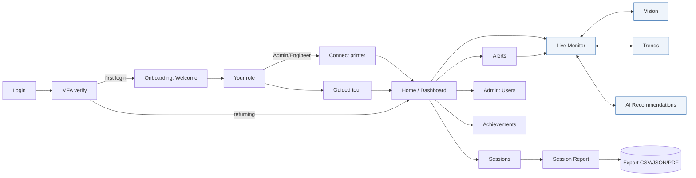

# 02 · Information Architecture, Screens & Routes

## 1. Screen inventory
| # | Screen | Route | Roles | Device | US | Fidelity |
|---|---|---|---|---|---|---|
| S01 | Login | `/login` | All | Desktop | 01 | Lo + Hi |
| S02 | MFA code | `/login/verify` | All | Desktop | 01 | Lo + Hi |
| S03 | Onboarding: Welcome | `/onboarding/welcome` | All (first login) | Desktop | — | Hi |
| S04 | Onboarding: Your role | `/onboarding/role` | All | Desktop | 02 | Hi |
| S05 | Onboarding: Guided tour (coach marks over Live Monitor) | `/onboarding/tour` | Operator | Tablet | 06, 07 | Hi |
| S06 | Onboarding: Connect printer & sensors | `/onboarding/printer` | Admin / Engineer | Desktop | — | Hi |
| S07 | **Home / Dashboard** (fleet overview) | `/dashboard` | All | Desktop | 03, 04, 06 | Lo + Hi |
| S08 | **Live Print Monitor** | `/prints/:jobId/live` | Operator, Engineer | **Tablet** (+desktop) | 03, 04, 06, 07 | Lo + Hi |
| S09 | **Vision** (camera + bead overlay) | `/prints/:jobId/vision` | Operator, Engineer | Tablet | 05, 07 | Lo + Hi |
| S10 | **Trends** (graph any value, time window) | `/prints/:jobId/trends` | All | Desktop | 08 | Lo + Hi |
| S11 | **AI Recommendations** (review queue + manual adjust drawer) | `/prints/:jobId/ai` | Engineer | Desktop | 09, 10, 11 | Lo + Hi |
| S12 | Alerts center | `/alerts` | All | Desktop | 06 | Lo + Hi (small) |
| S13 | Sessions history | `/sessions` | Engineer, Manager | Desktop | 12 | Lo |
| S14 | **Session Report** + Export | `/sessions/:sessionId/report` | Manager, Engineer | Desktop | 12, 13 | Lo + Hi |
| S15 | Admin › Users + Create user modal | `/admin/users` (`?new=1`) | Admin | Desktop | 02 | Lo + Hi |
| S16 | Achievements / Shift summary | `/me/achievements` | Operator, Engineer | Desktop/Tablet | gamification | Hi |
| S17 | Settings / Profile | `/settings` | All | Desktop | 01 | Lo only |

**Global elements:** top bar (logo, search, connection pill, alerts bell with count, role badge, avatar); navy sidebar (desktop) or bottom tabs (tablet); **persistent control bar on all `/prints/:jobId/*` routes** (US-07); global critical-alert banner on every route.

## 2. Sitemap
```
/login → /login/verify ─┬─(first login)→ /onboarding/welcome → /role → /tour | /printer → /dashboard
                        └─(returning)───────────────────────────────────────────→ /dashboard
/dashboard
 ├─ /prints/:jobId/live      ←→ /vision ←→ /trends ←→ /ai     (tabs inside a print; control bar persists)
 ├─ /alerts                  → deep link to /prints/:jobId/live?alert=:id
 ├─ /sessions → /sessions/:sessionId/report → [Export CSV | JSON | PDF]
 ├─ /admin/users  (Admin only)
 ├─ /me/achievements
 └─ /settings
```

## 3. Route / flow diagram (agent renders this to SVG for page 3)

Legend to add on the page: blue-tinted group = "inside a live print (control bar always visible)", dashed arrows = role-restricted.

## 4. Primary task flows (used in lo-fi annotations and the journey map)
1. **Operator catches a defect (US-03/04/05/06/07):** Dashboard → Live Monitor → warn banner "Layer width −9 %" → tap → Vision confirms bead is narrow → *Escalate to engineer* (or press-and-hold STOP if critical).
2. **Engineer acts on AI (US-09/10/11):** Push notification → AI Recommendations → read why + predicted effect → Modify 262 → 258 RPM → Accept → audit log entry → Live Monitor shows the new value and the predicted line converging.
3. **Manager reports (US-12/13):** Sessions → Session Report → review KPIs → Export PDF + CSV.
4. **Admin onboards a user (US-02):** Admin › Users → New user → role select → invite sent (MFA enrollment required).
