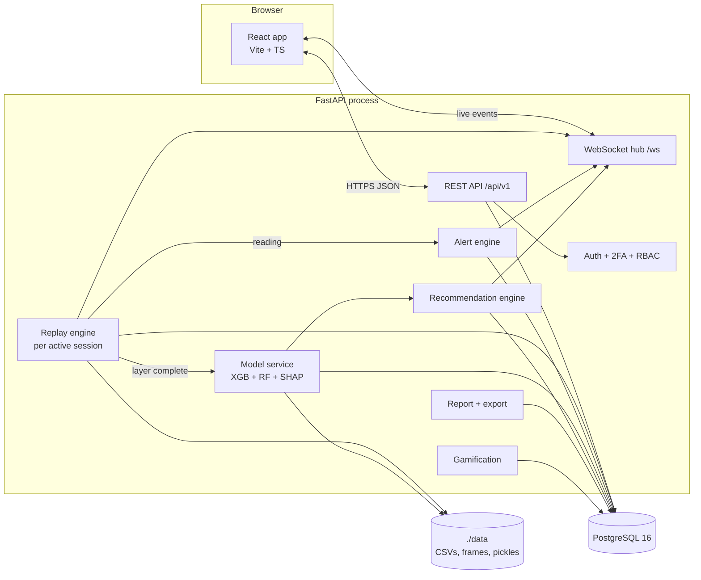

# 10 · Architecture

## 1. System diagram


**Event flow per tick (default 1 tick = 1 s of print time; demo speed configurable):**
1. Replay engine emits the next `Reading` (from CSV row + scenario overrides) → saved in a batch → broadcast `reading`.
2. Alert engine checks the reading against limits and predicted trends → opens/updates/resolves `Alert` → broadcast `alert`.
3. When the layer number increments → `Layer` row closed with measured width/height/delay → Model service builds features → `Prediction` rows (extrusion + interlayer) → Recommendation engine decides whether to propose a change → broadcast `prediction` / `recommendation`.
4. Accepted/modified/manual adjustments become `Adjustment` rows; the replay engine applies them to the following layers (see `14` §6), so the effect is visible on screen.

All of this runs **in-process** with asyncio tasks (one `SessionRunner` per active print session). No Celery/Redis needed for a single-laptop demo.

## 2. Repo layout
```
prime/
├─ CLAUDE.md
├─ docs/                       ← 00–19 plan files (00, 01 copied from Milestone II pack)
├─ docker-compose.yml
├─ .env.example
├─ Makefile                    ← make up / down / seed / reset-demo / test / e2e
├─ backend/
│  ├─ pyproject.toml           ← pinned versions (see §4)
│  ├─ alembic/ + alembic.ini
│  ├─ app/
│  │  ├─ main.py               ← FastAPI app, routers, startup (load models, resume runners)
│  │  ├─ config.py             ← pydantic-settings from env
│  │  ├─ db.py                 ← async engine/session
│  │  ├─ models/               ← SQLAlchemy ORM (one file per aggregate, see 11)
│  │  ├─ schemas/              ← Pydantic request/response models
│  │  ├─ api/v1/               ← auth.py users.py printers.py jobs.py sessions.py readings.py alerts.py
│  │  │                           predictions.py recommendations.py adjustments.py reports.py me.py demo.py
│  │  ├─ ws/hub.py             ← connection manager, channels, replay-from-seq
│  │  ├─ core/security.py, rbac.py, audit.py
│  │  ├─ replay/runner.py, source_csv.py, scenario.py, state.py
│  │  ├─ alerts/engine.py, rules.py
│  │  ├─ ml/registry.py, adapters.py, features.py, explain.py, recommend.py
│  │  ├─ reports/summary.py, export.py
│  │  ├─ gamification/score.py, badges.py
│  │  └─ seed/seed.py          ← users, printers, jobs, imported datasets
│  └─ tests/
├─ ml/
│  ├─ models/                  ← *.pkl (git-ignored if large) + model_config.yaml
│  └─ inspect_models.py        ← writes ml/MODEL_REPORT.md (T0.4)
├─ data/
│  ├─ raw/                     ← Kasra's CSVs (untouched)
│  ├─ mappings/*.yaml          ← column mapping per CSV
│  ├─ frames/<dataset>/        ← camera images
│  └─ scenarios/demo.yaml      ← the scripted demo story + overrides
└─ frontend/
   ├─ package.json, vite.config.ts, tailwind.config.ts
   └─ src/ (see 16)
```

## 3. Docker Compose (laptop)
```yaml
services:
  db:
    image: postgres:16
    environment: { POSTGRES_USER: prime, POSTGRES_PASSWORD: prime, POSTGRES_DB: prime }
    ports: ["5432:5432"]
    volumes: [pgdata:/var/lib/postgresql/data]
    healthcheck: { test: ["CMD-SHELL","pg_isready -U prime"], interval: 3s, retries: 20 }
  backend:
    build: ./backend
    env_file: .env
    depends_on: { db: { condition: service_healthy } }
    volumes: ["./data:/app/data", "./ml:/app/ml"]
    ports: ["8000:8000"]
    command: sh -c "alembic upgrade head && uvicorn app.main:app --host 0.0.0.0 --port 8000"
  frontend:
    build: ./frontend
    ports: ["5173:5173"]
    depends_on: [backend]
volumes: { pgdata: {} }
```
Also support running without Docker (`uvicorn --reload` + `npm run dev`) for development. Pre-pull images and build once **before** demo day; demo must not need internet.

## 4. Version pinning
- **xgboost / scikit-learn / numpy / pandas:** pin to the exact versions Kasra trained with (from `README` §5). If unknown, T0.4 tries loading with the latest versions, then steps down; record the working set in `ml/MODEL_REPORT.md`.
- Others: `fastapi`, `uvicorn[standard]`, `sqlalchemy>=2`, `asyncpg`, `alembic`, `pydantic>=2`, `pydantic-settings`, `pyotp`, `qrcode`, `argon2-cffi`, `pyjwt`, `shap`, `pyyaml`, `pytest`, `pytest-asyncio`, `httpx`.
- Front end: `react@18`, `react-router-dom@6`, `@tanstack/react-query@5`, `zustand`, `recharts`, `lucide-react`, `tailwindcss@3`, `@playwright/test`.

## 5. Environment variables (`.env.example`)
```
DATABASE_URL=postgresql+asyncpg://prime:prime@db:5432/prime
JWT_SECRET=change-me
ACCESS_TOKEN_MINUTES=15
REFRESH_TOKEN_DAYS=7
DEMO_MODE=true                 # enables /demo controls, seeded 2FA secrets, scenario overrides
DEMO_SPEED=8                   # replay speed multiplier (1 = real time)
MODEL_DIR=/app/ml/models
DATA_DIR=/app/data
CORS_ORIGINS=http://localhost:5173
```

## 6. Cross-cutting conventions
- All timestamps UTC in DB, shown in America/Chicago in UI.
- IDs: UUID v4 for entities; `bigserial` for high-volume `readings`.
- Every state-changing endpoint writes an `audit_log` row (`core/audit.py` dependency).
- Errors: `{ "error": { "code": "FORBIDDEN_ROLE", "message": "...", "details": {} } }`.
- Units stored in SI-ish canonical units listed in `11` (°C, RPM, kW, mm/s, mm, s).
