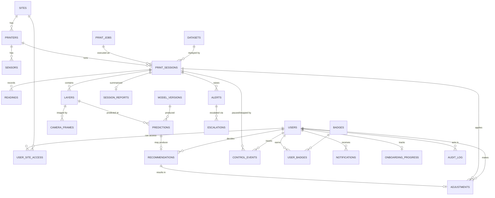

# 11 · Data Model (PostgreSQL)

> **Update (Nov 20, 2026):** real model inputs, units, value ranges and the demo story are now defined in [`20_data_and_models.md`](20_data_and_models.md). Where they differ, **doc 20 wins**.

## 1. ERD

## 2. Enums
| Enum | Values |
|---|---|
| `user_role` | `operator`, `engineer`, `admin`, `manager` |
| `session_status` | `scheduled`, `prechecking`, `running`, `paused`, `stopped`, `completed`, `aborted` |
| `signal` | `material_temp`, `ambient_temp`, `pump_rpm`, `pump_power`, `print_speed`, `layer_width`, `layer_height`, `interlayer_delay` |
| `severity` | `info`, `warning`, `critical` |
| `alert_status` | `open`, `acknowledged`, `resolved` |
| `alert_kind` | `out_of_range`, `predicted_out_of_range`, `sensor_lost`, `rapid_change` |
| `model_target` | `extrusion_rate`, `interlayer_delay` |
| `rec_status` | `pending`, `accepted`, `modified`, `rejected`, `expired`, `superseded` |
| `adjust_param` | `pump_rpm`, `print_speed` |
| `adjust_source` | `ai_accepted`, `ai_modified`, `manual` |
| `control_action` | `start`, `pause`, `resume`, `stop` |
| `value_source` | `recorded`, `scenario_override`, `adjusted` (provenance on readings/predictions) |

## 3. Tables
Common columns on every table except `readings`: `id uuid pk`, `created_at timestamptz default now()`.

### Identity & access
**users**: `email citext unique`, `full_name`, `password_hash`, `role user_role`, `totp_secret_enc` (encrypted, nullable until enrolled), `mfa_enrolled bool`, `is_active bool`, `last_login_at`, `created_by → users.id`.
**refresh_tokens**: `user_id → users`, `token_hash`, `expires_at`, `revoked_at`, `device_label`, `remember_device_until` (skip 2FA 30 days, US-01 design).
**sites**: `name` ("RECAST Lab"), `timezone`.
**user_site_access**: `user_id`, `site_id` (pk both). Admin sets in the Create-user modal.
**audit_log**: `user_id`, `action` (e.g., `recommendation.accept`), `entity_type`, `entity_id`, `before jsonb`, `after jsonb`, `ip`, `at`.

### Equipment & jobs
**printers**: `site_id`, `name` ("Gantry-02"), `bay` ("Bay 2"), `kind` (`gantry`/`robot_arm`), `nozzle_diameter_mm`, `rpm_min`, `rpm_max`, `speed_min`, `speed_max`, `is_active`.
**sensors**: `printer_id`, `signal signal`, `label`, `unit`, `status` (`live`/`calibrating`/`offline`), `last_seen_at`. (Drives the onboarding "Connect printer" checklist.)
**print_jobs** (the design to print): `name` ("Wall Panel WP-03"), `code` ("A-1027"), `total_layers`, `target_layer_width_mm`, `width_tolerance_mm`, `target_layer_height_mm`, `height_tolerance_mm`, `path_length_per_layer_m`, `material` ("C3DP mix M2"), `created_by`.
**signal_limits**: `job_id` (nullable = printer default), `printer_id`, `signal`, `normal_min`, `normal_max`, `critical_min`, `critical_max`, `rate_limit_per_min` (for `rapid_change`). One row per signal.

### Data & sessions
**datasets** (an imported CSV): `name`, `source_file`, `mapping_file`, `row_count`, `layer_count`, `duration_s`, `imported_at`, `notes`.
**print_sessions** (one run of a job): `job_id`, `printer_id`, `dataset_id` (nullable for future live mode), `scenario_name` (e.g., `demo`), `status session_status`, `started_at`, `ended_at`, `current_layer`, `current_rpm`, `current_speed`, `replay_cursor` (row index), `replay_speed`, `operator_id`, `engineer_id`, `quality_score numeric(5,2)`, `last_seq bigint` (WS sequence).
**readings** (high volume): `id bigserial pk`, `session_id`, `seq bigint`, `ts timestamptz`, `layer int`, `material_temp`, `ambient_temp`, `pump_rpm`, `pump_power`, `print_speed`, `layer_width`, `layer_height`, `interlayer_delay` (all `real`, nullable), `source value_source`. Index `(session_id, ts)`, unique `(session_id, seq)`.
**layers**: `session_id`, `layer_no`, `started_at`, `ended_at`, `measured_width_mm`, `measured_height_mm`, `interlayer_delay_s`, `avg_rpm`, `avg_speed`, `avg_material_temp`, `within_tolerance bool`. Unique `(session_id, layer_no)`.
**camera_frames**: `layer_id`, `image_path`, `width_mm`, `height_mm`, `edge_polyline jsonb`, `measurement_confidence`, `flagged_artifact bool`, `flagged_by`.

### ML
**model_versions**: `target model_target`, `algorithm` (`xgboost`/`random_forest`), `file_name`, `sha256`, `feature_names jsonb`, `trained_with jsonb` (lib versions), `metrics jsonb` (from Kasra, optional), `loaded_at`, `is_active`.
**predictions**: `session_id`, `layer_id`, `model_version_id`, `target`, `horizon_layers int` (1 = next layer), `predicted_value`, `unit`, `lower`, `upper` (interval), `confidence` (0–1), `features jsonb` (snapshot), `top_factors jsonb` (SHAP: `[{feature, value, contribution}]`), `observed_value` (filled later for accuracy), `source value_source`.
**recommendations**: `prediction_id`, `session_id`, `parameter adjust_param`, `current_value`, `proposed_value`, `reason_lines jsonb` (2 plain-language bullets), `predicted_effect jsonb` (`{signal, before:[..], after:[..]}` for the mini chart), `risk_text`, `confidence`, `status rec_status`, `expires_at_layer`, `decided_by`, `decided_at`, `final_value` (if modified), `reject_reason` (`sensor_artifact`/`material_change`/`disagree_model`/`other`), `reject_note`.
**adjustments**: `session_id`, `parameter`, `from_value`, `to_value`, `source adjust_source`, `recommendation_id` (nullable; null ⇒ manual, US-11), `user_id`, `note` (required when manual), `requested_at_layer`, `applied_at_layer`.

### Alerts, control, collaboration
**alerts**: `session_id`, `layer_no`, `signal`, `kind alert_kind`, `severity`, `message`, `value`, `threshold`, `status alert_status`, `raised_at`, `acknowledged_by`, `acknowledged_at`, `resolved_at`, `prediction_id` (for predicted alerts). Partial unique index: one `open` alert per `(session_id, signal, kind)`.
**escalations**: `alert_id` (nullable), `session_id`, `from_user_id`, `to_user_id`, `message`, `created_at`, `seen_at`, `responded_at`.
**control_events**: `session_id`, `action control_action`, `user_id`, `at`, `layer_no`, `reason`.
**notifications**: `user_id`, `kind` (`alert`, `escalation`, `recommendation`, `nudge`, `badge`, `report_ready`), `title`, `body`, `link`, `read_at`.

### Reporting & gamification
**session_reports**: `session_id unique`, `generated_at`, `kpis jsonb` (duration, layers, alerts by severity, adjustments by source, prediction MAE + accuracy %, quality score), `summary_text`, `parameters_table jsonb`.
**badges**: `code` (`first_catch`, `early_bird`, `steady_hands`, `model_partner`, `calibrated`, `safety_first`), `name`, `description`, `icon`, `threshold`.
**user_badges**: `user_id`, `badge_id`, `progress int`, `earned_at` (null = in progress).
**onboarding_progress**: `user_id unique`, `welcome_done`, `role_seen`, `tour_done`, `practice_stop_done`, `first_live_watched`, `first_alert_ack`, `dismissed`.
**shift_goals**: `site_id`, `shift_label` ("Shift B"), `date`, `goal_text`, `target`, `progress`.

## 4. Key relationship rules
- A **session** belongs to exactly one job and one printer; at most **one `running`/`paused` session per printer** (partial unique index).
- A **recommendation** is created only from a prediction; at most one `pending` recommendation per `(session_id, parameter)`: a newer one marks the old one `superseded`.
- An **adjustment** with `recommendation_id` must have source `ai_accepted` or `ai_modified`; without it, source must be `manual` and `note` is required (DB check constraint).
- `predictions.observed_value` is back-filled when the predicted layer closes → powers "prediction accuracy" in reports (US-13).
- Deleting is not exposed in the UI; users are deactivated (`is_active=false`) to keep the audit trail.

## 5. Seed data (`make seed`)
- Site: *RECAST Lab*.
- Users (password `Prime!2026`, TOTP secrets fixed in `seed.py` when `DEMO_MODE=true`): Maya Ortiz (operator), Dev Patel (engineer), Sam Lee (admin), Jordan Brooks (manager), + Kasra and Carlos as admins.
- Printers: Gantry-02 (Bay 2), Arm-01 (Bay 1), Gantry-03 (Bay 3, idle) with sensors and limits from `00_project_context.md`.
- Jobs: Wall Panel WP-03 (120 layers), Column C-12, Footing F-2.
- Datasets: imported from `data/raw/*.csv` via mappings.
- Sessions: one **completed** historical session (so Sessions/Report pages have content before the live demo), one **scheduled** WP-03 session wired to `scenarios/demo.yaml`, and Arm-01 running a calm background replay.
- Badges catalog; Maya with 4/6 earned, Dev with *Model Partner* at 7/10.
