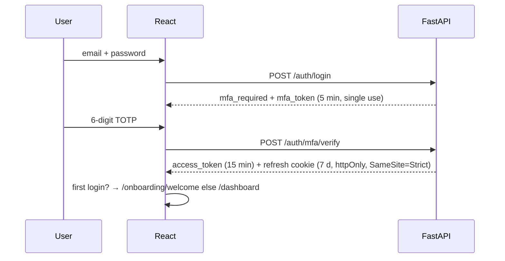

# 13 · Authentication & Role-Based Access

## 1. Login flow (US-01)

- Passwords: argon2id. Lockout after 5 failed attempts for 5 minutes (shown as a friendly message).
- TOTP: `pyotp`, 30-s window, ±1 step tolerance; secret encrypted at rest (Fernet key from env).
- "Remember this device for 30 days": sets `remember_device_until` on the refresh token; login then skips MFA on that browser.
- Not enrolled yet (new user from Admin): after password, show QR enrollment screen (`/login/enroll`) before access.
- **Demo mode:** seeded users have fixed TOTP secrets printed by `make seed` (add them to your phone's authenticator before rehearsal). Additionally, if `DEMO_MODE=true`, a backup code `246810` works for seeded users only. Never enabled when `DEMO_MODE=false`.

## 2. Authorization
- Every router uses a dependency `require(permission)`; permissions map to roles in `core/rbac.py` (single source of truth, unit-tested as a matrix).
- Front end mirrors the same matrix in `src/auth/permissions.ts` (generated from `GET /me` permissions list) to show **locked** buttons with a lock icon and tooltip "Engineer approval required" rather than hiding them.
- Site scoping: users only see printers/sessions of sites in `user_site_access` (admins see all).

## 3. Permission matrix
| Permission | Operator | Engineer | Admin | Manager |
|---|:-:|:-:|:-:|:-:|
| View dashboard, live values, camera, aggregated trends | ✓ | ✓ | ✓ | ✓ |
| Start / pause / resume / stop a session | ✓ | ✓ | — | — |
| Acknowledge alert · flag frame as artifact | ✓ | ✓ | — | — |
| Escalate to engineer | ✓ | — | — | — |
| View raw sensor data | — | ✓ | ✓ | — |
| Accept / modify / reject AI recommendation | — | ✓ | — | — |
| Manual RPM / speed adjustment | — | ✓ | — | — |
| Resolve alert | — | ✓ | — | — |
| Create sessions, edit jobs/limits, sensor test | — | ✓ | ✓ | — |
| View sessions history, reports | — | ✓ | ✓ | ✓ |
| Export session data (CSV/JSON/PDF) | — | ✓ | — | ✓ |
| Manage users and roles | — | — | ✓ | — |
| Demo controls (`DEMO_MODE`) | — | — | ✓ | — |

## 4. Audit
Logged actions: login success/failure, MFA enroll, user create/update, session control actions, alert ack/resolve, escalation, recommendation decisions, manual adjustments, exports, demo controls. Viewable by Admin at `/admin/audit` (simple table; lower priority).
