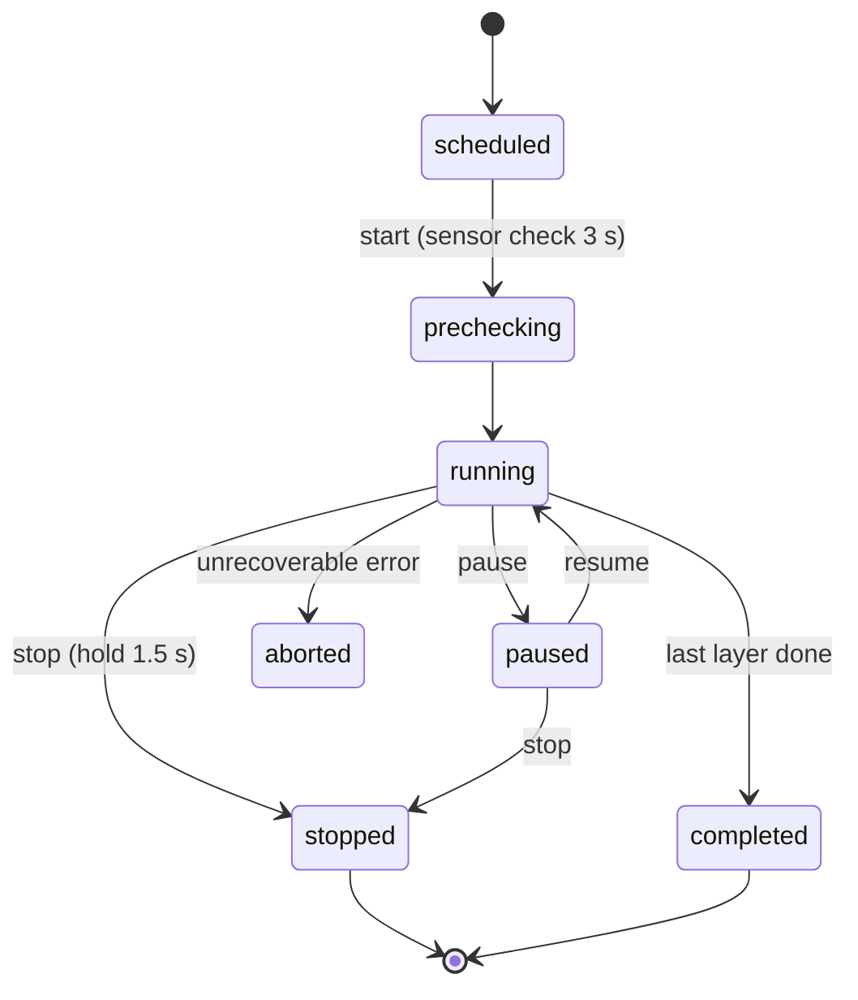

# 17 · Feature Logic (business rules)

## 1. Session control state machine (US-07)

- Every transition writes `control_events` + `audit_log` and broadcasts `control`.
- Stop/pause must be acknowledged by the server in < 300 ms (runner checks a flag each tick, not after the layer).
- On `stopped`/`completed` → report generated automatically → notification "Report ready".

## 2. Alert engine (US-06)
Evaluated on every reading (and on every prediction for predicted alerts):
| Kind | Rule | Severity |
|---|---|---|
| `out_of_range` | value outside `normal_min/max` for ≥ 3 consecutive readings | warning |
| `out_of_range` | value outside `critical_min/max` for ≥ 2 readings | critical |
| `rapid_change` | abs(change per minute) > `rate_limit_per_min` | warning |
| `predicted_out_of_range` | prediction at any horizon outside normal range | warning (info if horizon ≥ 6 layers) |
| `sensor_lost` | no value for a signal for ≥ 5 s of sim time | critical |
- Layer width uses tolerance from the job: normal = target ± tolerance; critical = target ± 2×tolerance.
- **Hysteresis:** resolve automatically after 10 consecutive in-range readings (prevents flapping).
- One open alert per (session, signal, kind); updates bump `value` instead of duplicating.
- Message templates (plain language, US-06): "Layer width 36.4 mm is below target (40 ± 3) and dropping. Check Vision."
- On new warning/critical: notification to the session's operator; critical also notifies the engineer.

## 3. Escalation
Operator presses "Escalate to engineer" → `escalations` row → notification + WS to the on-duty engineer (session `engineer_id`, else any engineer with site access) → operator sees receipt "Dev Patel (Engineer) was notified · usually responds in ~2 min" (median of past responses, default 2 min). When the engineer opens the AI tab or decides on a recommendation, `responded_at` is set and the operator gets "Dev is reviewing".

## 4. Adjustments (US-10, US-11)
- Validation: within printer limits; max step ±30 RPM / ±20 mm/s per change; manual requires a note.
- Applied at the next layer start by the runner (`applied_at_layer`); UI shows "Applies at layer 43".
- Manual adjustments are always logged as `manual` ("independent engineer decision"), and if a pending recommendation existed for the same parameter, it becomes `superseded` (the record shows where engineer judgment differed from the model).

## 5. Quality score (0–100, live and in report)
`score = 100 × (0.6 × layers_within_tolerance_ratio + 0.25 × alert_response_factor + 0.15 × decision_factor)`
- `alert_response_factor = clamp(1 − (median_ack_seconds − 15) / 120, 0, 1)`
- `decision_factor` = share of recommendations that got a human decision (accept/modify/reject) before expiring.
Recomputed per layer; stored on `print_sessions.quality_score`.

## 6. Report generation (US-13)
KPIs: duration, layers done/total, alerts by severity, median ack time, adjustments by source, prediction accuracy per model, quality score. Charts: predicted vs observed width/delay, alerts timeline. Tables: parameters (start/end/min/max), adjustment log.
**Summary text:** deterministic template filled from KPIs (no external LLM, works offline), e.g. "The print finished on schedule in 2 h 05 m. One under-extrusion episode at layer 41 was corrected by a +16 RPM adjustment accepted by Dev Patel; layer width recovered within 3 layers. Prediction accuracy: extrusion 91 %, interlayer delay 93 %." Editable by E/M before export (stored in `session_reports.summary_text`).

## 7. Export (US-12)
- CSV zip: `readings.csv`, `predictions.csv`, `adjustments.csv`, `alerts.csv` (canonical column names + units in headers).
- JSON: one document `{session, job, printer, readings[], layers[], predictions[], recommendations[], adjustments[], alerts[], report}`.
- PDF: print stylesheet (see `16` §5).
- Export writes `audit_log` (`session.export`).

## 8. Gamification
| Badge | Rule (evaluated on events) |
|---|---|
| First Catch | acknowledged an alert ≤ 15 s after it opened |
| Early Bird | escalated while only a `predicted_out_of_range` alert was open |
| Steady Hands | 100 consecutive in-tolerance layers on sessions you operated |
| Model Partner | 10 recommendation decisions (any outcome) |
| Calibrated | completed a sensor test / camera calibration |
| Safety First | completed hold-to-stop practice in onboarding |
- **Clean-print streak:** consecutive in-tolerance layers in the current session (resets on any warning).
- **Shift goal:** team goal row (e.g., 3 prints ≥ 90 quality); progress from completed sessions in the shift.
- **Shift summary:** layers monitored, alerts handled + avg response, defects prevented (= warnings resolved without reaching critical), badges earned.
- Badge earned → notification + toast. No individual leaderboards (Milestone II guardrail).

## 9. Nudges (server-generated `notification` kind `nudge`)
Predictive heads-up (on `predicted_out_of_range`), unacknowledged warning > 30 s, escalation receipt, decision closure ("Applied at layer 43. Width recovering: 38.9 mm"), shift hand-off reminder (10 min before shift end), end-of-print summary. Users can mute nudge types in Settings. Never sent while a critical alert is open (except critical itself).

## 10. Onboarding
`onboarding_progress` drives: Welcome → Role → Tour (coach marks over Live Monitor of a *practice* session; hold-to-stop practice calls a no-op endpoint and sets `practice_stop_done`) → Connect printer (E/A). Dashboard checklist widget reads the same flags. Skippable; resumable.
